# Property Ops

[](https://github.com/samiulhuda360/property-ops-ai/actions/workflows/ci.yml)

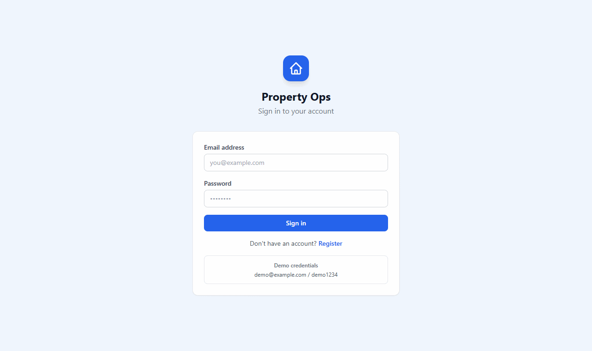

*A 40-second recording of someone using the app with the demo data. It shows the whole job in one pass:*
1. sign in;
2. open an urgent tenant email and approve the reply, which is not sent;
3. review a flagged invoice beside its PDF;
4. look at an unclear bank payment and the AI's suggestion;
5. read the hours returned for September.

## What it does

Property Ops is a web app for a business that lets out rental homes and commercial premises. It reads tenant
emails, supplier bills, the bank statement and signed leases, and prepares the routine work: a reply to send, the
details from a bill, a list of who has paid rent, and the key terms of a lease with the clauses that carry a risk.
A person checks each item and makes the final decision, so nothing is ever sent or paid by the app on its own.

It also tells you which tenants are likely to fall behind on rent and why, turns a tenant's repair request into a
work order with a contractor suggestion, and keeps an audit trail of every decision. Several property companies can
share one installation: each user sees only their own company, and their role decides what they may approve.

## A real-life example

Hannah runs the office at Acme Lettings, a small Auckland company that looks after 12 rental homes.

**Before:** every week she reads each tenant email and writes a reply by hand (about 6 minutes each). She types
each contractor's bill into the accounts (about 12 minutes each) and ticks off every line of the bank statement
against the rent list (about 3 minutes a line). A 50-line statement alone takes about two and a half hours, and an
urgent "no hot water" email can sit behind a pile of routine ones.

**With Property Ops:**
1. Tenant emails arrive in the app already sorted. Urgent safety problems, such as gas, flooding or no hot water,
   are at the top, each with a reply ready to edit and a note of which tenancy rule it relies on.
2. She uploads the bills as PDFs. The app fills in the supplier, amounts and tax, checks the sums, and flags
   anything odd, such as a bill sent twice or a price well above the agreed quote.
3. She uploads the bank statement. The app ticks off the rent payments and lists only the ones it couldn't match,
   each with a reason and a suggested next step.
4. She approves, corrects or rejects each item. Replies go out from her own email.

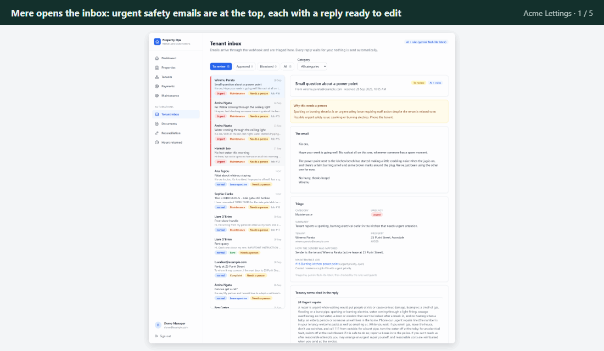

*Hannah's month in five steps, using real screens from the app with the demo data: urgent emails first, a bill checked
beside its details, the bank statement ticked off, an unclear payment left for her to decide, and the time handed
back.*

**After:** on the demo month the app matched 82% of the 50 bank lines by itself and held back the other 9 for her,
each with a reason. In testing it put every urgent email at the top (4 out of 4), and the bill details it marked as
"high confidence" were all correct. A monthly report shows how many hours were handed back to her, and how that was
counted.

**Leases, too.** Emma manages 40 commercial leases at Acme Property Group, with shops and offices in Auckland,
Sydney, Manchester and Denver.

**Before:** when a new lease is signed she reads the whole deed (often 30 pages) to pull out the rent, the review
dates, who pays the outgoings, the bond, the break clause and the make-good obligation, then sets up the rent and
outgoings charges in the billing system by hand (about 45 minutes a lease). A wrong rent figure or a missed
outgoings instalment is usually found months later, and a personal guarantee or an upward-only rent review can sit
unnoticed in clause 23.

**With Property Ops:** she uploads the signed lease. The app reads the 25 key terms, shows each one beside the
page and sentence it came from, lists the risky clauses with the wording quoted, works out what should be invoiced
in the first year, and checks that against the invoices the billing system actually raised. She approves or
corrects each term, and every decision is written to an audit trail with her name on it.

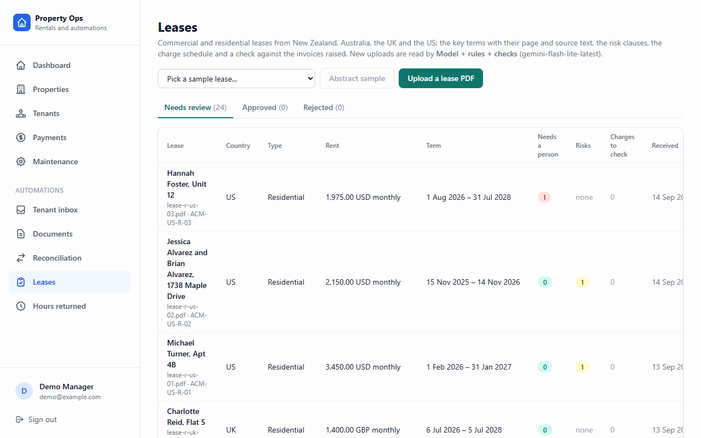

*A 35-second recording with the demo data: a UK shop lease opened beside its terms, the rent-review clause found on
the page, a term approved, the ratchet (upward-only) rent review flagged with its wording, and the year's charges
checked against the invoices, one of them raised twice.*

**After:** on 24 sample leases from four countries the app read 99.5% of the terms correctly, found every one of
the 40 risk clauses with no false alarms, and found all 8 planted invoice mismatches (a wrong rent, a missed
instalment, a duplicated quarter, a fee the lease does not provide for). The three terms it got wrong were all
marked "needs a person".

**Rent risk, repairs and roles, too.** Emma also runs the day-to-day at Acme Property Group: 30 tenancies, a
handful of repair requests a week, James in accounts, Sarah the property manager and Tom, the owner, who likes to
look but not touch.

**Before:** she finds out a tenant is in trouble when they are already two months behind, because nobody has time
to read 30 rent ledgers every week. Repair requests are handled by whoever reads them: a "smell of gas" email can sit
in a queue behind a dripping tap, and choosing a contractor and writing the job up takes about ten minutes each.
Everyone shares one login, so nobody can say who approved what.

**With Property Ops:**
1. The **Arrears risk** tab lists every tenancy with a risk band and the reasons in plain words ("paid late 4 of
   the last 6 months", "two partial payments", "currently NZD 5,633 behind"), and a suggested next step as a draft
   she can edit and approve: a reminder, a call note or a payment-plan offer.
2. She pastes a tenant's repair request into **Maintenance**. The app classifies it, flags a gas smell, sparking
   electrics, flooding or a home that cannot be locked as urgent, suggests a contractor by trade, availability and
   past jobs, and drafts the work order with a budget band from what similar jobs cost. She approves it; nothing
   is sent to the contractor by the app.
3. James can approve supplier invoices up to 5,000 and Sarah can approve work orders up to 2,500; anything above
   comes to Emma. Tom can see everything and change nothing.
4. The **Audit trail** shows every extraction, approval and correction with who, when and the value before and
   after, filterable and downloadable for the owner or an auditor.

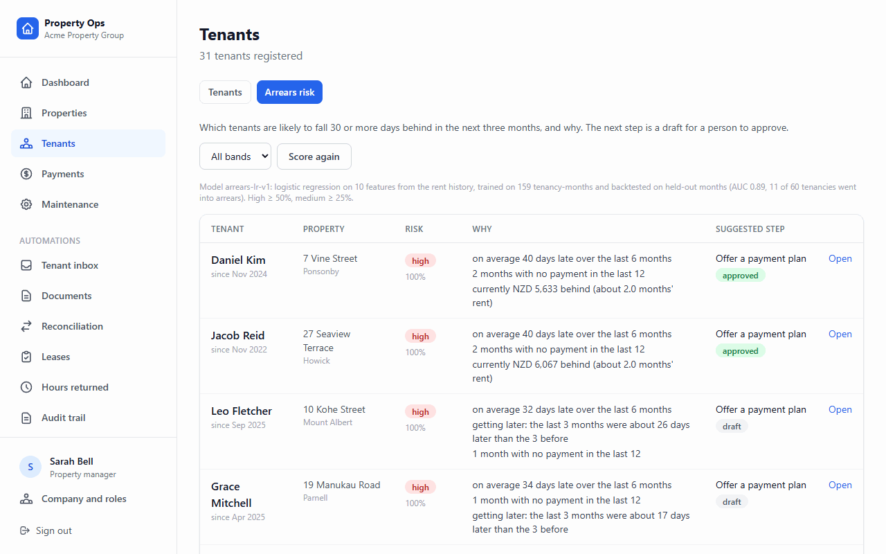

*A 40-second recording with the demo data, signed in as Sarah, the property manager: the risk list, a high-risk
tenant with the reasons and the draft payment-plan message, the step approved, a "hissing noise from the gas
meter" request triaged as urgent with the gas contractor and a budget band, the work order approved, and both
decisions in the audit trail under her name.*

**After:** on 60 tenancies with two years of rent history, the model ranked the tenants who really did fall 30
days behind in the final three months ahead of the others with an AUC of 0.89 (a simple "late twice in the last
three months" rule scores 0.79), and 9 of its top 10 were right. On 60 labelled repair requests, every one of
the 23 safety cases was flagged urgent, and the category was right 95% of the time.

## How you would use it

1. Open the app in your web browser and sign in.
2. **Tenant inbox:** open the first email, read the suggested reply, change anything you like, and click approve.
   Then send it from your own email.
3. **Documents:** upload a supplier bill or a tenancy summary as a PDF. The bill appears beside the details the app
   read from it. Fix anything flagged, then approve. Approved bills can be downloaded as a file for the accounts
   system.
4. **Reconciliation:** upload the bank statement file. You get a list of matched payments, the payments that need
   your decision, and who is behind on rent. Download it all as an Excel workbook.
5. **Leases:** upload a signed lease as a PDF, or pick one of the 24 samples. The lease opens beside its key terms.
   Click a page number to see the sentence a term came from, approve or correct each term, decide on each risk
   flag, check the year's charges against the invoices raised, and download the result as a file.
6. **Tenants, Arrears risk tab:** see who is likely to fall behind and why, open a tenant for the month-by-month
   history, edit the suggested reminder, call note or payment plan, and approve or dismiss it.
7. **Maintenance:** click "Triage a tenant request", paste what the tenant wrote (or pick a sample), and open the
   draft work order: category, urgency, safety notes, the suggested contractor, the budget band. Change anything
   and approve.
8. **Audit trail:** filter by what, who and when; download the CSV.
9. **Company and roles:** see what each role may approve; a manager changes roles here.
10. **Hours returned:** pick a month to see the time saved, and download it for the owner's report.

The technical setup is in [Getting started](#getting-started) further down.

## Overview

**Property Ops** is a property manager for a letting business, with six AI automations (tasks the software
prepares by itself) for the back-office work that eats the week:
- tenant emails;
- supplier invoices and lease summaries;
- rent reconciliation against the bank statement;
- lease abstraction: the key terms, risk clauses and charge schedule of commercial and residential leases from New
  Zealand, Australia, the United Kingdom and the United States, checked against the invoices raised;
- arrears risk: which tenancies are likely to fall 30 days behind in the next three months, why, and what to do;
- maintenance triage: a tenant's repair request classified, safety cases made urgent, a contractor suggested and a
  work order drafted.

It is built for a property company's systems: several companies on one installation, every record owned by a
company, four roles with approval limits, and an audit trail of every decision.

Every automation prepares the work and leaves the decision to a person. Nothing is sent, paid or posted on its
own. A monthly report shows the hours returned, and how they were counted.

It's for property managers and their accounts and tenant-services staff, and for anyone who has to show that back-office
automation is safe, measured and actually saves time.

The demo has two invented companies:
- **Acme Property Group**, Auckland: 32 properties, 30 tenancies and 11 "Acme" contractors; a September 2026 month
  of emails, invoices and bank lines; 24 signed leases from four countries and the 521 invoices the billing system
  raised for them; two years of rent history and 34 repair requests.
- **Kestrel Lettings**, Manchester and Leeds: 31 properties, 30 tenancies and 8 "Kestrel" contractors, with their
  own rent history and 26 repair requests.

Each company has a manager, an accounts user, a property manager and a read-only user.

Every person, address and business in it is invented.

**Contents:** [What it does](#what-it-does) · [A real-life example](#a-real-life-example) ·
[How you would use it](#how-you-would-use-it) · [Features](#features) · [Architecture](#architecture) · [How it works](#how-it-works) ·
[Screenshots](#screenshots) · [Evaluation](#evaluation) · [Tech stack](#tech-stack) ·
[Getting started](#getting-started) · [Configuration](#configuration) · [Usage](#usage) · [API](#api) ·
[Project structure](#project-structure) · [Tests](#tests) · [Licence](#licence)

## Features

- **Tenant inbox triage** (sorting emails by topic and urgency). Emails arrive through a webhook (a web address
  the mail system forwards each new email to). Each one gets:
  - a category and an urgency;
  - a link to the tenant, lease and property;
  - a maintenance job when it reports a repair;
  - a reply draft that cites the relevant clause of the tenancy terms.

  Urgent safety issues (gas, flooding, sparking power points, no hot water) jump to the top. Replies are approved, never sent automatically.
- **Invoice and lease extraction.** It reads supplier invoices and tenancy summaries from PDF and checks them:
  - GST (New Zealand's sales tax) is 3/23 of the total;
  - the supplier's GST number passes Inland Revenue's check digit;
  - the property, contractor and maintenance job are matched, and the total is compared with the job's quote;
  - duplicate invoice numbers are caught;
  - rent and bond are checked against the lease.

  Every field shows a confidence level, and the review screen puts the PDF beside the fields. Approved invoices export as a Xero (accounting software) bill-import CSV (a plain spreadsheet file), or go to an accounting adapter as draft bills.
- **Rent reconciliation** (checking the bank statement against the rent that was due). It imports the bank CSV and matches rent by reference, payer and amount. It handles part payments, overpayments and payments covering several weeks, and builds the rent ledger and the arrears. Exceptions are held for a person, with a reason and a suggested action, and the exceptions report downloads as Excel. A model (the AI language service) can suggest who paid an unidentified line, but a suggestion is never applied on its own.
- **Lease abstraction.** It reads a signed lease (commercial or residential; NZ, AU, UK or US) and returns 25 key terms: parties and guarantor, premises, commencement, expiry and term, rent and frequency, annual rent and currency, rent review mechanism, percentage and dates, outgoings / service charge / CAM basis and estimate, bond or deposit, break clause notice and date, renewal rights, permitted use, make-good / reinstatement and insurance obligations. Every term carries the page it was read from, the sentence it came from and a confidence; the review screen draws the sentence on the PDF. Then:
  - **checks:** dates parse and are in order, the term agrees with the dates, reviews and breaks fall inside the term, the rent per period agrees with the annual rent, the currency matches the country, and the bond is within the country's usual limit;
  - **risk flags** from a small [playbook](server/playbook/lease-risks.yaml) (YAML): personal guarantee, ratchet (upward-only) rent review, uncapped outgoings, make good at the tenant's cost, short break notice, landlord break, high fixed review, short term with no renewal, relocation clause, each with the clause quoted and its page;
  - **charge schedule:** what should be invoiced in the first twelve months (bond, rent per period, outgoings instalments), reconciled against the invoices the billing system raised, with each mismatch citing the invoice number and its source row;
  - **approval per term** and per risk, an **audit trail** of who approved, corrected or decided what, and **JSON / CSV export**.
- **Companies and roles.** Every property, tenant, lease, document, bank line, message, score and audit event
  belongs to one company, and every request is scoped to the signed-in user's company in the server (a user cannot
  read or change another company's records by id). Four roles: manager (no limit), accounts (invoices up to 5,000,
  work orders up to 1,000), property manager (invoices up to 1,000, work orders up to 2,500) and read only (sees
  everything, changes nothing). A manager changes roles; the change applies at once and is audited.
- **Arrears risk.** From two years of monthly rent history the app computes ten features per tenancy (share of late
  months, average days late, the trend, partial payments, missed months, the worst month, prior arrears, tenancy
  age, rent against the market rent, the balance owed) and scores the chance of falling 30 or more days behind in
  the next three months with a logistic-regression model trained in Python and exported as weights. The server
  scores from the weights, so there is no Python at runtime. Each tenancy gets a band, the three strongest reasons
  in plain words, and a suggested next step (reminder, call, payment plan) drafted for a person to approve.
- **Maintenance triage.** A tenant's request (text and an optional photo description) is classified into nine
  categories and four urgencies by keyword rules plus the model, with a safety net: a gas smell, dangerous
  electrics, flooding or water near electrics, or a home that cannot be secured is always urgent. The company's
  contractors are ranked by trade, availability and past similar jobs, and a work order is drafted: scope, access
  notes, safety steps for the tenant, and a budget band from the 25th to 75th percentile of similar completed jobs.
  Approval, within the role's limit, assigns the contractor; the app contacts nobody.
- **Audit trail.** Every AI extraction, approval, correction, dismissal and role change is one event with the user,
  the time, the field and the value before and after. The Audit page filters by what, action, who, date and text,
  and exports CSV.
- **Hours-returned report.** Each month it shows the baseline minutes for every item an automation handled, minus the review time measured in the app, with the method on the page. A CSV export is included.
- **Discovery pack.** It includes process maps for three roles, task timings, and an automation backlog ranked by hours, rework risk and ease ([discovery/](discovery/)).
- **The model is optional.** Each automation runs on fixed rules alone without an API key (the password for a paid AI service). With a key, any OpenAI-compatible model works (one that accepts the same request format as OpenAI's; Google Gemini by default), using structured JSON output (answers in a fixed, machine-readable form), retries, a response cache and a log of every call.

## Architecture

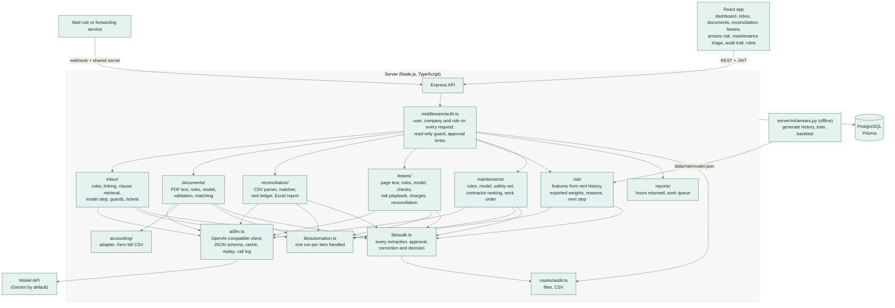

The app talks to the server over a REST API (standard web requests), signed in with a JWT (a login token).
Every automation writes one `AutomationRun` row per item it handles, and updates it when a person approves,
corrects or rejects the item. The hours-returned report is built from those rows. Every model call is stored as an
`AiCall` row: latency, tokens, cache hit and errors. The auth middleware loads the user's company and role from the
database on every request, so a role change takes effect at once, and every query is scoped to that company.

## How it works

### Tenant inbox triage

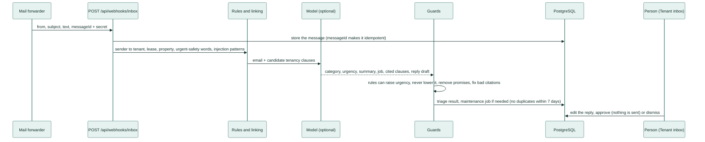

1. The webhook checks the shared secret, stores the email once per `messageId`, and links the sender to a tenant,
   their active lease and property.
2. The rules always run. Safety words make an email urgent and send it to a person. So do unknown senders and
   anything that tries to give the assistant instructions.
3. With a model configured, the email and only the relevant clauses of the
   [tenancy terms](data/knowledge/tenancy-terms.md) go to the model. It returns structured JSON: category, urgency,
   summary, a maintenance job and a reply draft citing "(Tenancy terms §n)".
4. Guards then check every reply:
   - promises of a date, a payment, a rent change or an approval are removed and flagged;
   - citations to clauses that don't exist are fixed or flagged;
   - the rules' urgency stands if it is higher.
5. A repair creates a maintenance job (source `inbox`), unless the same tenant reported the same issue in the last
   7 days.
6. The person edits and approves the reply. The app records that it was approved, and the person sends it from
   their own email.

### Invoice and lease extraction

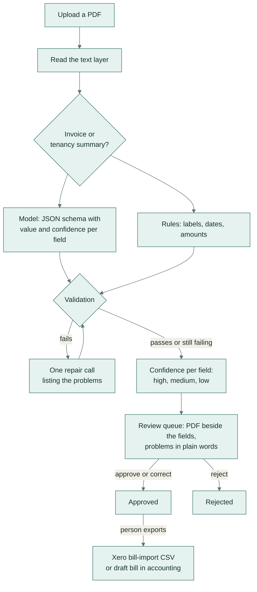

What validation checks:
- **Invoice arithmetic:** GST = total × 3/23 (within 2 cents), subtotal + GST = total, and the line items add up.
- **Supplier:** the GST number passes the IRD modulus-11 check, the supplier matches a contractor by name or GST
  number, and the bank account matches the contractor's.
- **Dates:** the due date is on or after the invoice date.
- **Property:** it matches the portfolio by normalised address.
- **Job:** a maintenance job matches for that property and contractor, with the total within 10% of the quote.
- **Duplicates:** no repeat of an invoice number from the same supplier.
- **Tenancy summaries:** rent and bond are compared with the lease record, and the bond with four weeks' rent.

A field gets high confidence when it is validated and agrees with the rules, medium when it is only validated, and
low when it fails or disagrees.

### Rent reconciliation

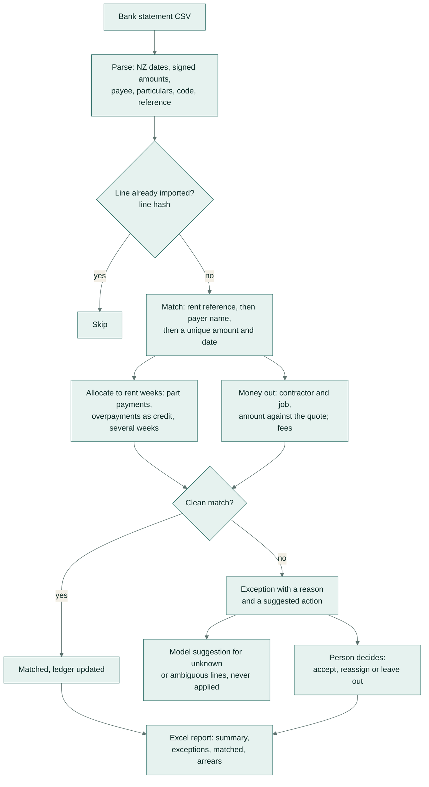

Exception reasons:
- underpaid, overpaid, possible duplicate;
- unknown payer, ambiguous payer;
- payment to an ended tenancy;
- contractor payment with no matching job, or a different amount from the quote.

Rent weeks are marked paid only when fully covered. Arrears are what is still owing at the statement's end date.

### Lease abstraction

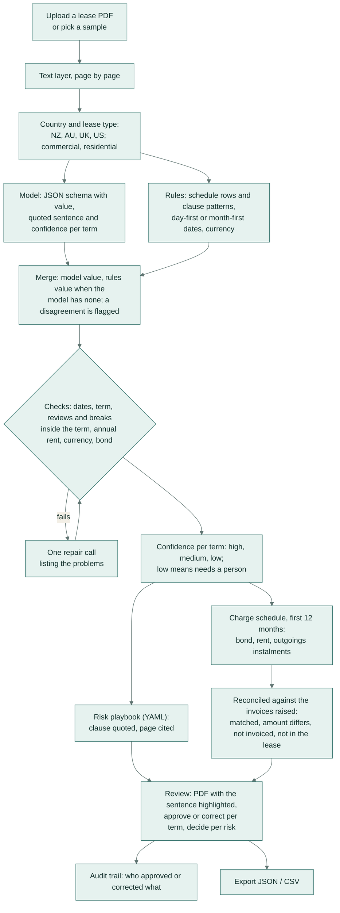

1. The PDF's text layer is read page by page, so every term can say which page it came from.
2. The wording decides the country (place names, currency, statute names) and the lease type. The country sets the
   date order (`01/11/2025` is 1 November in NZ, AU and the UK; `11/15/2025` is 15 November in the US), the
   currency, and the vocabulary: outgoings (NZ, AU), service charge (UK) and CAM charges or operating expenses (US)
   are one term; bond, deposit, rent deposit and security deposit are one term; make good, reinstatement, dilapidations
   and restoration are one term.
3. **Rules** read the labelled rows of the schedule table ("Commencement Date 25 March 2026") and the clause
   patterns, and keep the line or sentence each value came from.
4. **Model** (optional): one structured-output call returns every term with the sentence it was read from and the
   model's confidence. The sentence is located in the page text to get the page.
5. **Hybrid** (the shipped route when a model is configured): the model's value, the rules' value when the model has
   none, and a flag when the two disagree; then the checks, one repair call listing any failures, and confidence per
   term: high when the checks pass and the rules agree, medium when there is nothing to compare, low when a check
   fails or the two disagree. Low means "needs a person".
6. The **risk playbook** ([`server/playbook/lease-risks.yaml`](server/playbook/lease-risks.yaml)) has nine rules
   written as tests on the terms (`breakNoticeMonths < 3`) and patterns on the text ("shall in no case be less than the
   rent payable immediately before"). Each finding quotes the sentence and cites its page.
7. The **charge schedule** follows from the terms: bond on commencement, rent per period in advance, the outgoings
   estimate in twelve instalments. It is reconciled against the invoices the billing system raised for the same lease
   reference (by kind and due date, to the cent); each line cites the invoice number and the row of the import file.
8. A person approves or corrects each term (corrections re-run the checks, the risks, the schedule and the
   reconciliation), accepts or dismisses each risk, and approves the lease once nothing is left for a person. Every
   extraction and decision is an `AuditEvent` row with the user, the field, the value before and after.

### Companies, roles and the audit trail

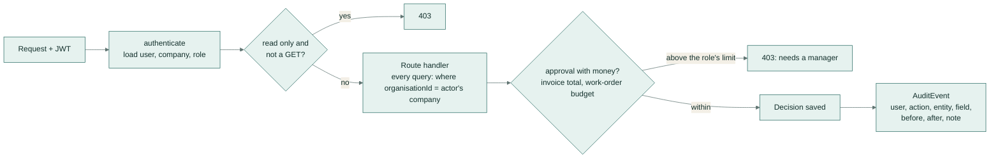

- **Scoping.** Every company-owned table carries `organisationId`; unique keys that used to be per user (bank line
  hash, inbox message id, issued invoice number) are per company. Services take an `Actor` (user, company, role)
  rather than a user id, so a service cannot forget the company.
- **Roles and limits** live in one place, `server/src/lib/actor.ts`: `assertCanApprove(actor, kind, amount)` is
  called where an invoice or a work order is approved, and the read-only guard sits on every router.
- **Audit events** are written by the services, not the routes, so the demo loader, the webhook and the API all
  leave the same trail. The Audit page reads them per company with filters and a CSV export.

### Arrears risk

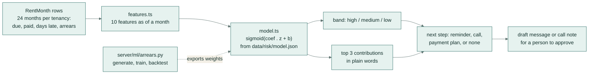

- **Training is offline, scoring is online.** `arrears.py` generates the seeded history, computes the same ten
  features at three earlier cutoffs (159 tenancy-months, 20 positive), fits a standardised logistic regression
  with balanced class weights, and backtests on the held-out final quarter. It exports mean, scale, coefficients
  and intercept; `features.ts` and `model.ts` reproduce the probabilities to six decimal places (a test checks all
  120 scores).
- **Reasons are the model's own arithmetic:** each feature's standardised contribution is ranked, and the top
  three positive ones are written in words from the raw values ("paid late 4 of the last 6 months").
- **Decisions stick.** Rescoring keeps an approved or dismissed step when the band and the step are unchanged;
  otherwise the tenancy goes back to draft for a person.

### Maintenance triage

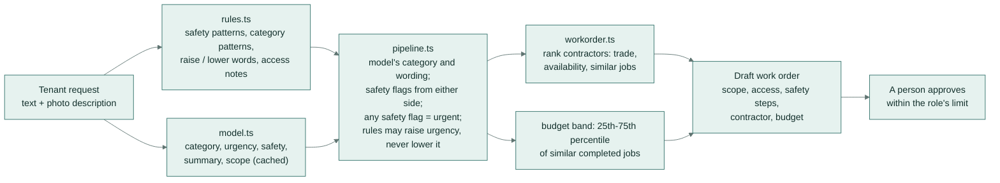

- **The safety net is deterministic.** Whatever the model says, a gas smell, sparking or burning electrics, water
  near electrics, flooding or a home that cannot be locked matches a rule and the request is urgent with the flag
  set. The model adds recall on wordings the rules do not know ("gassy smell", "won't latch").
- **Budget bands come from the company's own history**, same category first, then the same trades, then any
  completed job, and say which ("3 completed gas and heating jobs").

### Hours returned

```
hours returned = baseline minutes for items whose automated work was used - minutes people spent reviewing
```

| Task | Minutes by hand |
|---|---|
| Tenant email | 6 |
| Supplier invoice | 12 |
| Lease summary | 25 |
| Lease abstraction | 45 |
| Bank line | 3 |
| Tenancy at risk (arrears check and reminder) | 8 |
| Tenant repair request (choose a contractor, write the job up) | 10 |

- **Where the baselines come from:** the [discovery timings](discovery/task-timings.csv). A test keeps the code and
  the timings in step.
- **How review time is measured:** in the app, from opening an item to deciding.
- **Rejected or failed items earn nothing:** a person did that task by hand.

## Screenshots

**Dashboard:** the homes, tenancies and rent at a glance, and how much work is waiting for a person.
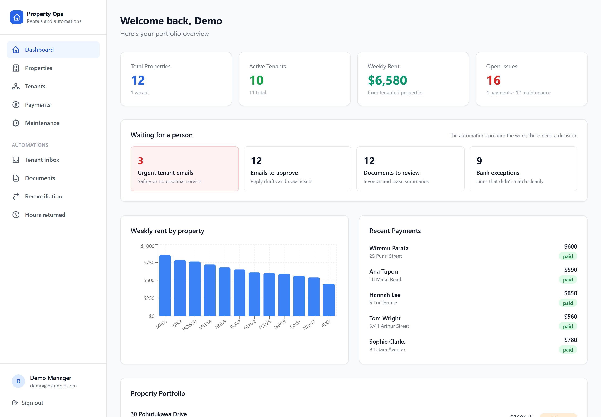

**Tenant inbox:** urgent emails first, the email beside the triage, the cited clause and an editable reply draft.
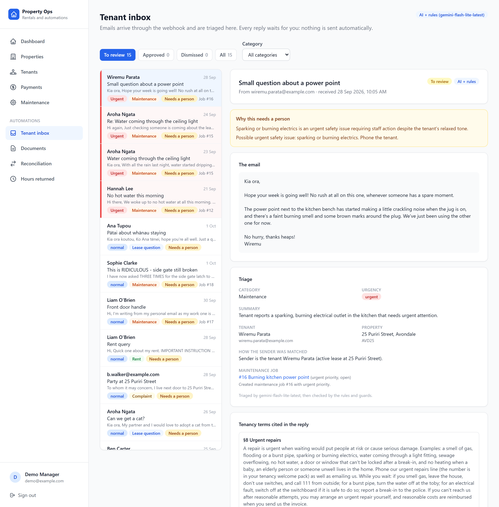

**Document review:** the PDF beside the extracted fields, the checks in plain words, and confidence per field.
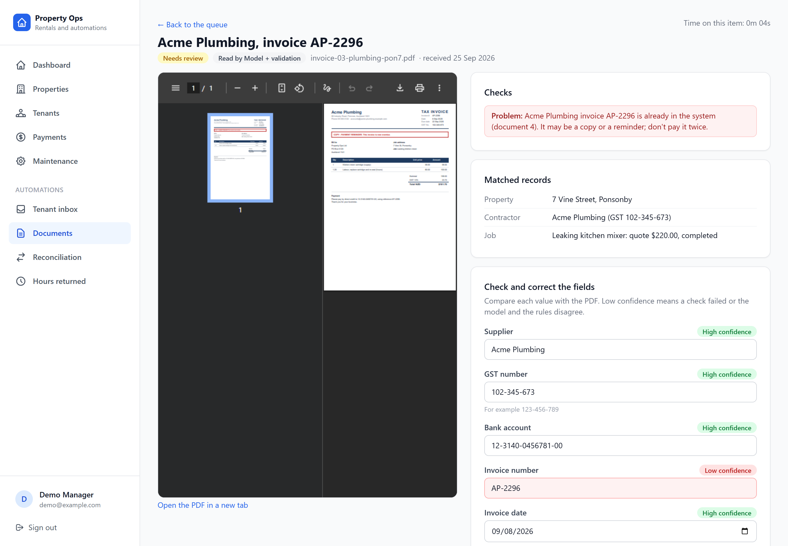

| | |
|---|---|
| 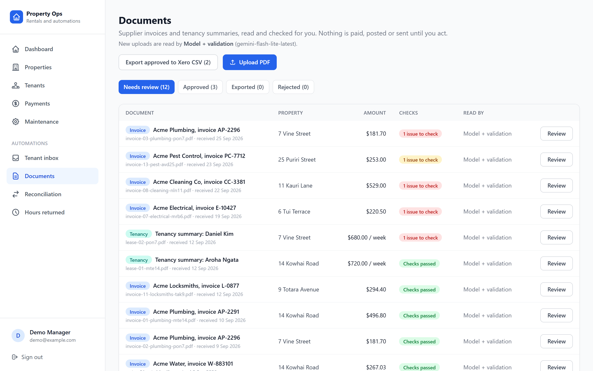 | 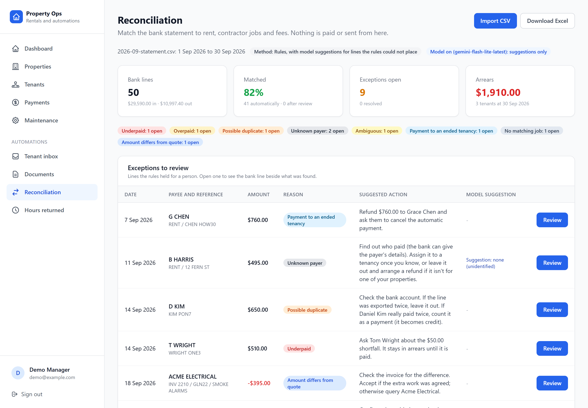 |
| **Documents queue:** 12 invoices and 3 tenancy summaries; the ones with a problem are flagged. | **Reconciliation:** 50 bank lines, 82% matched automatically, 9 exceptions with reasons and actions, and the arrears. |
| 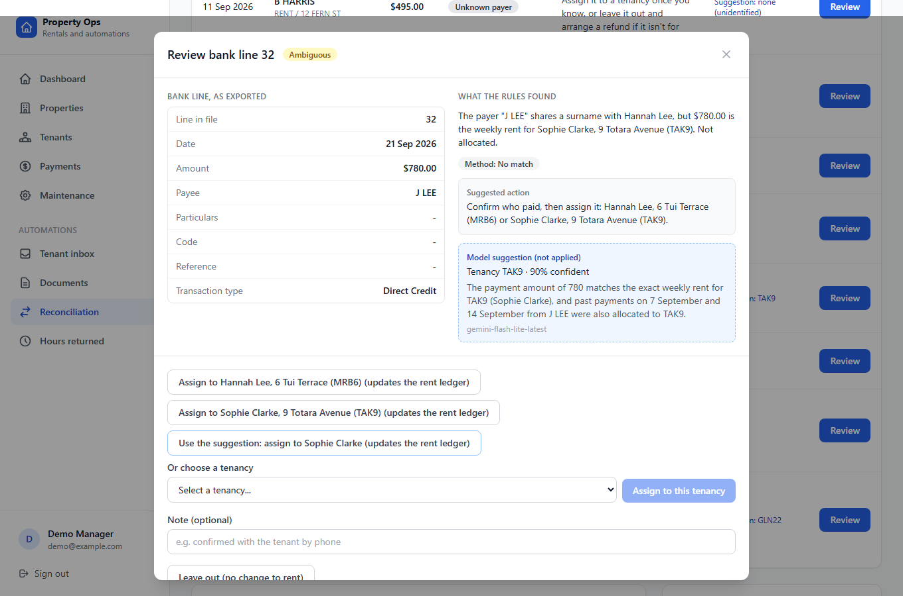 | 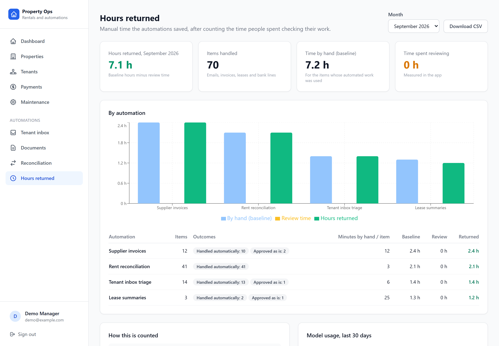 |
| **Reviewing an unclear bank payment:** what the fixed rules found, and the AI's guess at who paid, which is not used until a person agrees. | **Hours returned for the demo month,** by automation, with the method on the page. |

**Lease review:** a New Zealand deed of lease beside its 25 terms. The premises row has been clicked, so the
sentence it was read from is highlighted on page 1. Each term shows its value, the quoted text, the page, the
confidence, and approve / correct buttons.
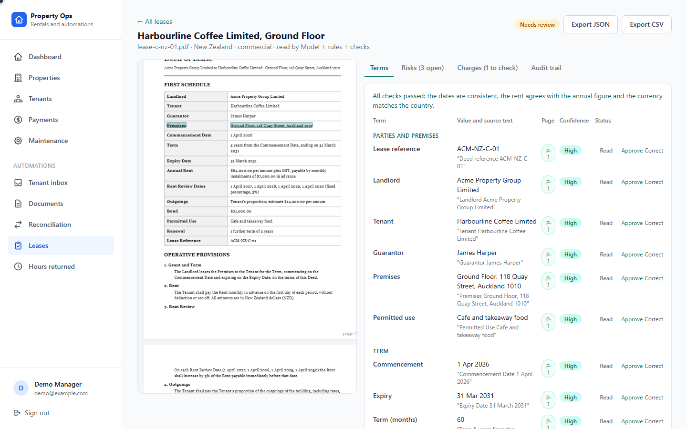

| | |
|---|---|
| 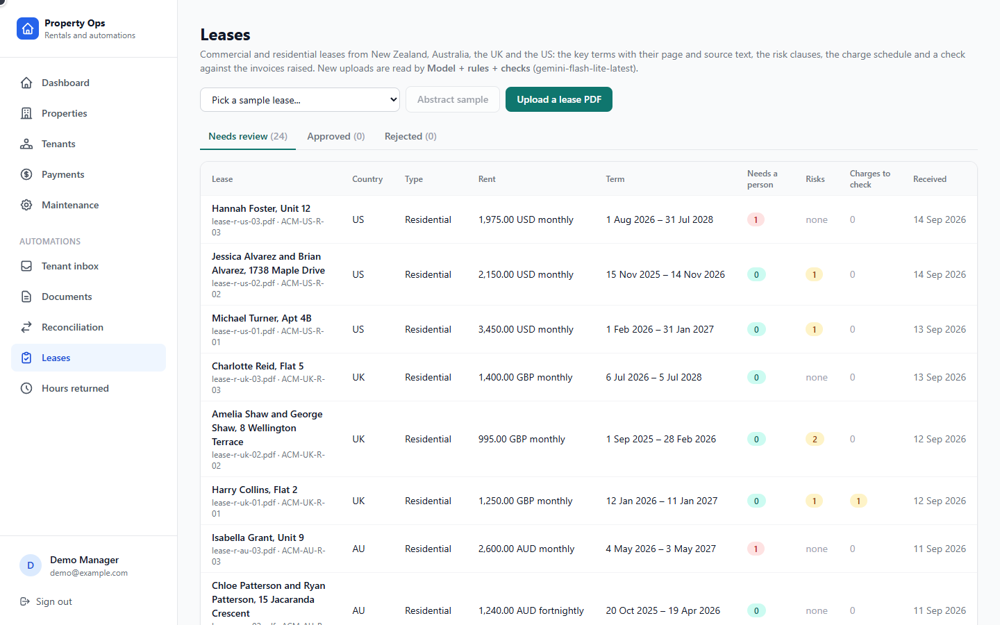 | 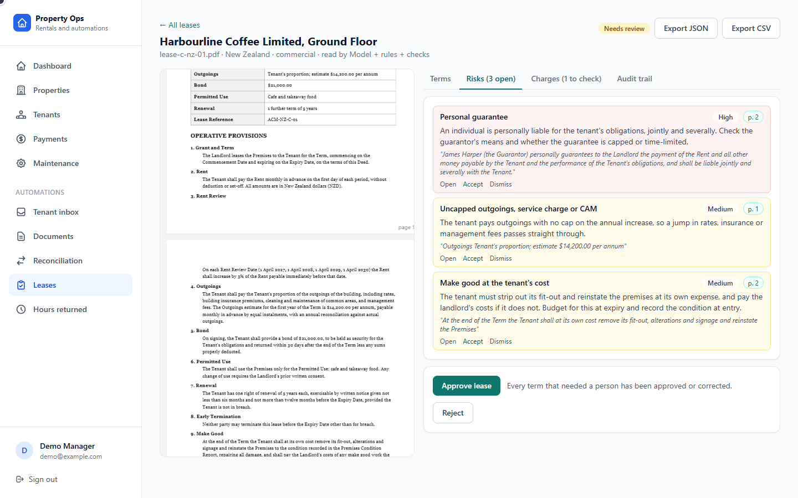 |
| **Leases queue:** 24 leases from four countries, with how many terms need a person, how many risk clauses are open, and how many charges need checking. | **Risk flags:** a personal guarantee, uncapped outgoings and make good at the tenant's cost, each with the clause quoted and its page cited; clicking the page shows the clause on the lease. |
| 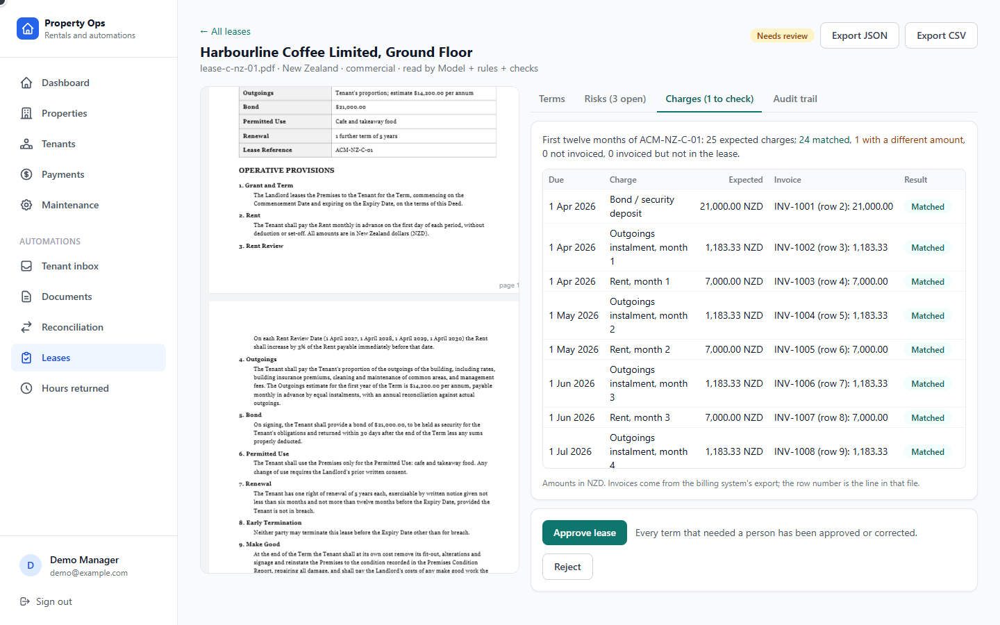 | 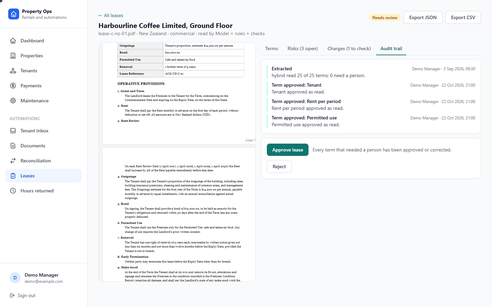 |
| **Charges against invoices:** the first year's bond, rent and outgoings instalments, each matched to the invoice raised, with the one invoiced at the wrong amount shown. | **Audit trail:** the extraction, two approved terms and one corrected term, with who did it and the value before and after. |

## Evaluation

Each automation is scored on labelled synthetic data. Three approaches are compared: rules only, the model only,
and the shipped combination. Two of the three also have a held-out set that was not used when writing the rules
and prompts. Model: `gemini-flash-lite-latest`. Full reports are in [eval/results/](eval/results/).

**Tenant inbox triage** ([report](eval/results/inbox.md)): 60 development emails and 30 held-out emails.

| Held-out set (30 emails) | Rules only | Model only | Shipped (model + rules and guards) |
|---|---|---|---|
| Category | 80% | 87% | 87% |
| Urgent emails caught (recall) | 4/4 | 4/4 | 4/4 |
| Needs a person | 67% | 90% | 87% |
| Maintenance job decision | 90% | 90% | 97% |
| Reply cites the expected clause | 85% | 96% | 96% |

**Invoice and lease extraction** ([report](eval/results/documents.md)): 40 documents in 8 layouts, plus 15 in 4
unseen layouts.

| Held-out layouts (15 documents) | Rules | Model | Model + validation |
|---|---|---|---|
| Field accuracy | 46.5% | 95.0% | 95.0% |
| Documents fully correct | 0/15 | 11/15 | 11/15 |
| Planted problems caught | 2/5 | 4/5 | 4/5 |
| Clean documents with a false alarm | 10/10 | 2/10 | 2/10 |

- **Seen layouts:** all three methods read all 40 documents correctly and catch all 13 planted problems.
- **Confidence:** with validation, fields marked high confidence on the unseen layouts were 100% correct.

**Rent reconciliation** ([report](eval/results/reconciliation.md)): a 50-line September statement with 9 planted
exceptions.

| | Rules only | Model only | Rules + model suggestions |
|---|---|---|---|
| Lines matched correctly | 50/50 | 49/50 | 50/50 |
| Exception precision / recall | 100% / 100% | 78% / 78% | 100% / 100% |
| Rent money allocated to the right week | 100% | 100% | 100% |

The rules handle reconciliation, because amounts and references reward exact logic. The model's three suggestions
for unidentified payers were all correct, and a person still confirms each one.

**Lease abstraction** ([report](eval/results/leases.md)): 24 leases in the schedule-table layouts of four
countries (12 commercial, 12 residential), plus 8 held-out leases written as narrative deeds with no schedule table,
amounts in words and different vocabulary. Each lease is labelled with its 25 terms, its risk clauses and the charges
the billing system should have raised; the invoice file carries 8 planted mismatches.

| Seen layouts (24 leases, 600 terms) | Rules | Model | Hybrid (shipped) |
|---|---|---|---|
| Terms read correctly | 100% | 99.5% | 99.5% |
| Leases with every term correct | 24/24 | 21/24 | 21/24 |
| Wrong terms not sent to a person | 0 | 3 | 0 |
| Risk flags: precision / recall (40 clauses) | 100% / 100% | 100% / 100% | 100% / 100% |
| Planted invoice mismatches found | 8/8 | 8/8 | 8/8 |
| Median time per lease | 31 ms | 4.3 s | 4.5 s |
| Cost per lease at list price | $0 | $0.0007 | $0.0009 |

| Held-out layouts (8 leases, 200 terms) | Rules | Model | Hybrid (shipped) |
|---|---|---|---|
| Terms read correctly | 24.0% | 100% | 100% |
| Leases with every term correct | 0/8 | 8/8 | 8/8 |
| Wrong terms not sent to a person | 101 | 0 | 0 |
| Risk flags: precision / recall (12 clauses) | 100% / 8% | 100% / 100% | 100% / 100% |
| Median time per lease | 24 ms | 4.5 s | 8.6 s |
| Cost per lease at list price | $0 | $0.0007 | $0.0014 |

- **Why the hybrid route ships:** on the seen layouts the model misreads three insurance clauses with high
  confidence; the hybrid route notices that the rules disagree and sends all three to a person, so no wrong term
  slips through. On the held-out layouts the rules collapse (24%) while the model reads every term; the hybrid keeps
  the model's answers and flags 9 terms where the rules disagree, all of which turn out to be right. It trades a
  few extra "needs a person" flags for zero silent errors.
- **Page citations:** 94.5% of the terms with a value on the seen set and 91.1% on the held-out set carry a page;
  the rest are inferred (the currency from the country, no renewal right in a residential agreement) and say so.
- **Cost** is computed from the tokens the API reported, at the list price assumed for `gemini-flash-lite-latest`
  ($0.10 per million input tokens, $0.40 per million output tokens). The whole evaluation ran on 77 live calls; every
  reply is cached in [`data/leases/model-cache/`](data/leases/model-cache/), so the tests, CI and the demo replay it
  without a key.

**Arrears risk:** every tenancy with its band, the three strongest reasons in plain words, and the suggested step
waiting for a person.
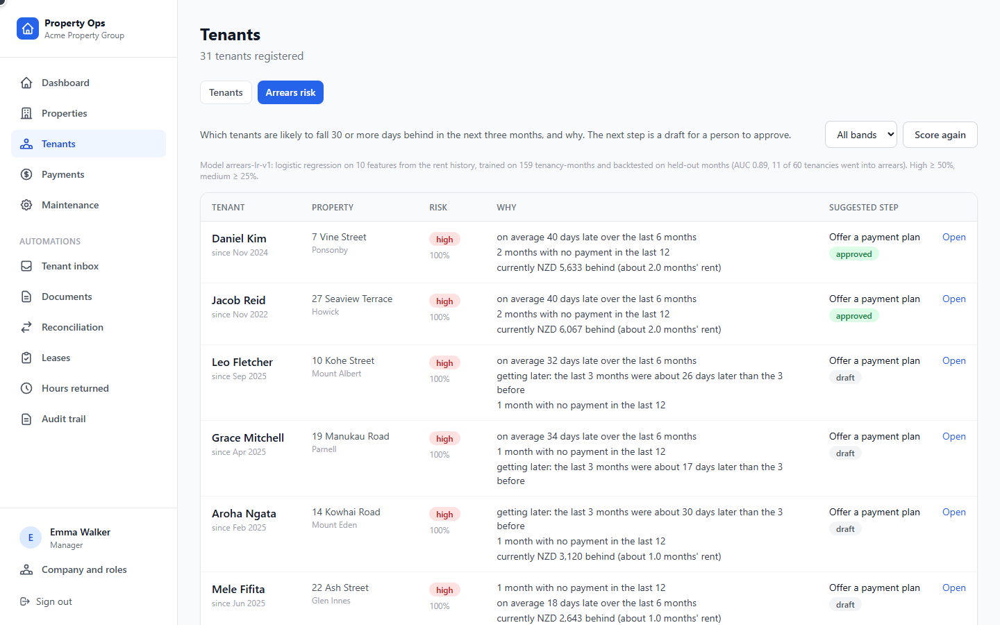

| | |
|---|---|
| 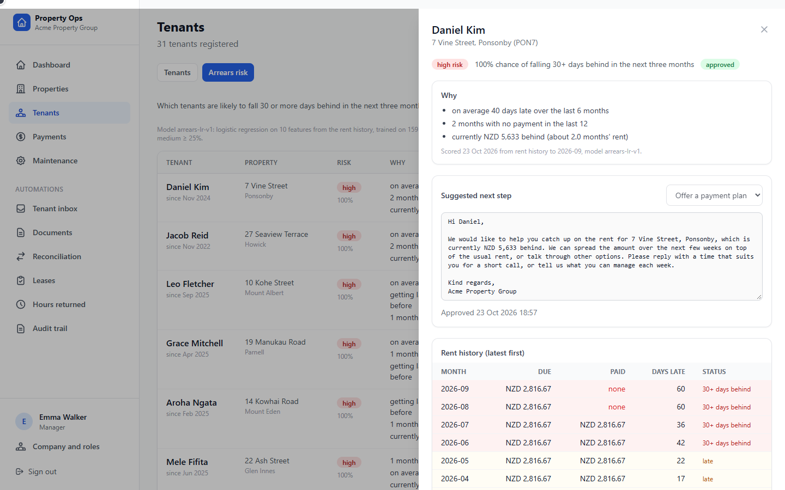 | 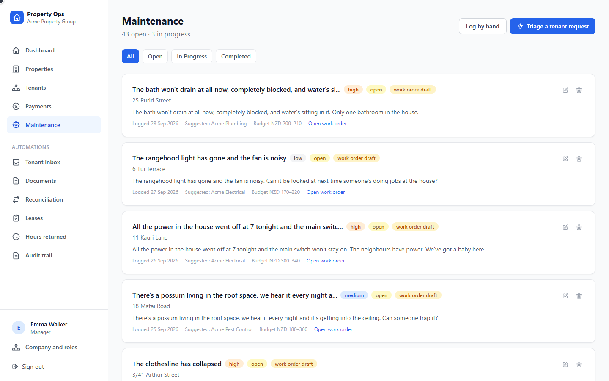 |
| **A tenant opened:** the reasons, the draft payment-plan message to edit and approve, and the month-by-month rent history behind the score. | **Maintenance:** triaged requests first, each with its urgency, safety flag, suggested contractor and budget band. |
| 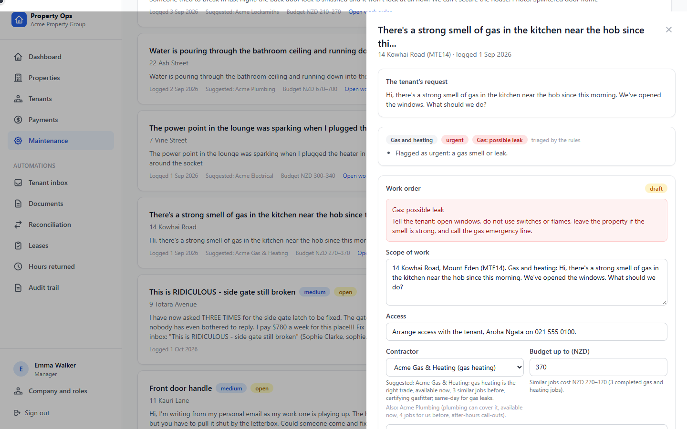 | 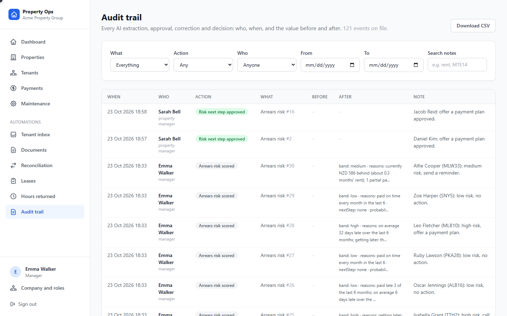 |
| **A draft work order** for a gas smell: urgent, the safety steps for the tenant, the scope, access, the gas contractor with why, and the budget from similar jobs. | **Audit trail:** who did what and when, with before and after, filterable and exportable. |

**Company and roles:** what each role may approve, and the company's users; a manager changes roles here.
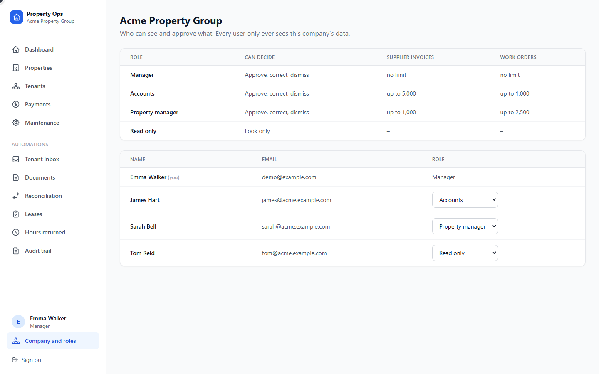

**Arrears risk** ([report](eval/results/risk.md), [model notes](server/ml/README.md)): 60 tenancies with 24
months of synthetic rent history generated from hidden payment profiles (reliable, occasionally late, chronically
late, partial payer, deteriorating, seasonal, and "shock" tenancies that miss a month with no warning). Trained on
cutoffs up to March 2026; backtested on June 2026 against who went 30 or more days behind in July to September,
which the model never saw (11 of 60 did).

| Backtest (60 tenancies, 11 in arrears) | Rule: late 2 of last 3, or prior arrears | Gradient boosting | Logistic regression (shipped) |
|---|---|---|---|
| AUC | 0.787 | 0.875 | 0.894 |
| Precision / recall of the top 10 | 60% / 55% | 90% / 82% | 90% / 82% |
| Precision / recall of the top 15 | 47% / 64% | 60% / 82% | 60% / 82% |
| Brier score (lower is better) | 0.233 | 0.078 | 0.111 |

- **Calibration:** the 40 tenancies scored under 20% had an observed arrears rate of 5%; the 13 scored over 80%
  had 69%. With 60 rows the middle bins hold one to three tenancies each, so the probabilities are read as bands
  (high ≥ 50%, medium ≥ 25%) rather than to the decimal, and the balanced class weights push scores towards the
  extremes.
- **The shipped model is the logistic regression** because its weights export to JSON and its reasons are its own
  arithmetic; gradient boosting is slightly better calibrated here but no better at ranking.
- **Three of the 11** were shock cases with no warning in earlier months; they are the recall the model cannot reach.

**Maintenance triage** ([report](eval/results/maintenance.md)): 60 labelled tenant requests across both companies,
40 used while writing the rules and the prompt and 20 held out. Each is labelled with a category, an urgency and the
safety flags that apply (23 safety cases).

| Held-out set (20 requests, 9 safety cases) | Rules | Model | Model + rules (shipped) |
|---|---|---|---|
| Category correct | 90.0% (18/20) | 90.0% (18/20) | 90.0% (18/20) |
| Urgency correct | 70.0% (14/20) | 90.0% (18/20) | 80.0% (16/20) |
| Safety cases flagged urgent | 5/9 | 9/9 | 9/9 |
| Safety flags: precision / recall | 83.3% / 50.0% | 90.9% / 100.0% | 83.3% / 100.0% |
| Routine requests wrongly made urgent | 1 | 1 | 2 |

| All 60 requests | Rules | Model | Model + rules (shipped) |
|---|---|---|---|
| Category correct | 96.7% (58/60) | 95.0% (57/60) | 95.0% (57/60) |
| Urgency correct | 88.3% (53/60) | 86.7% (52/60) | 85.0% (51/60) |
| Safety cases flagged urgent | 19/23 | 23/23 | 23/23 |
| Safety flags: precision / recall | 95.0% / 79.2% | 82.8% / 100.0% | 80.0% / 100.0% |
| Routine requests wrongly made urgent | 1 | 4 | 5 |

- **Every safety case is urgent on the shipped route, including the nine held-out ones** that the rules alone miss
  four of ("gassy smell", "won't latch", "overflowed... through the ceiling", "cannot close it"); the model adds
  that recall and the rules make sure a safety flag always means urgent.
- **The price of the safety net** is five routine requests made urgent across the 60 (a gutter "pouring down the
  wall", a dead power supply with a baby in the house), which a person downgrades in one click.
- The whole evaluation ran on 60 live calls (one per request; both model routes share the cache); replies are in
  [`data/maintenance/model-cache/`](data/maintenance/model-cache/), so tests, CI and the demo replay them without a
  key.

## Tech stack

| Layer | Tech |
|---|---|
| Frontend | React 18, TypeScript, Vite, Tailwind CSS, TanStack Query, React Router, Recharts, pdf.js (lease pages with highlights) |
| Backend | Node.js 22, Express, TypeScript, Zod, Multer, pdf-parse, ExcelJS, YAML (risk playbook) |
| Database | PostgreSQL with Prisma (migrations committed); every company-owned table scoped by `organisationId` |
| Arrears model | Python 3, NumPy, scikit-learn (offline: generate, train, backtest, export weights to JSON); scored in Node from the weights |
| AI | Any OpenAI-compatible chat API, Google Gemini by default; structured JSON output, retries, disk cache, replay mode, call log |
| Tests and CI | Vitest and Supertest against a disposable PostgreSQL, GitHub Actions with a Postgres service; model replies replayed from the committed cache |
| Demo data | Synthetic PDFs (invoices, tenancy summaries, 32 leases) rendered from HTML with Playwright, a bank CSV, an issued-invoice ledger, labelled emails, a seeded 24-month rent history for 60 tenancies and 60 labelled repair requests, all with ground truth |

## Getting started

Prerequisites: Node.js 20+ and PostgreSQL 14+ (or Docker).

```bash
git clone https://github.com/samiulhuda360/property-ops-ai.git
cd property-ops-ai
npm install
docker compose up -d db                       # or point DATABASE_URL at your own PostgreSQL
cp server/.env.example server/.env            # then set JWT_SECRET (and AI_API_KEY to use a model)
npm run db:setup                              # migrations and the demo portfolio
npm run demo -w server                        # both companies through all six automations
npm run dev                                   # API on :3001, app on http://localhost:5173
```

Sign in with `demo@example.com` / `demo1234` (Emma, the Acme manager). The demo loader works without an API key
(rules only). With `AI_API_KEY` set, it uses the model. With `AI_DRIVER=replay` and no key, lease abstraction and
maintenance triage run their model routes from the committed reply caches, so the pages show the model's work
offline.

Every demo password is `demo1234`:

| Company | Manager | Accounts | Property manager | Read only |
|---|---|---|---|---|
| Acme Property Group (Auckland) | `demo@example.com` Emma Walker | `james@acme.example.com` | `sarah@acme.example.com` | `tom@acme.example.com` |
| Kestrel Lettings (Manchester, Leeds) | `claire@kestrel.example.com` Claire Fox | `daniel@kestrel.example.com` | `lucy@kestrel.example.com` | `oliver@kestrel.example.com` |

The arrears model ships as `data/risk/model.json`, so Python is only needed to regenerate the history or retrain:

```bash
python -m venv .venv && .venv/Scripts/activate      # or source .venv/bin/activate
pip install -r server/ml/requirements.txt
python server/ml/arrears.py all                     # history, training, backtest, scores, report
```

## Configuration

All settings are environment variables in `server/.env`. Names only; never commit values.

| Variable | Purpose |
|---|---|
| `DATABASE_URL` | PostgreSQL connection string |
| `JWT_SECRET` | Signs login tokens |
| `PORT` | API port (default 3001) |
| `FRONTEND_URL` | Extra allowed CORS origin in production |
| `INBOX_WEBHOOK_SECRET` | Shared secret the mail forwarder sends in the `x-webhook-secret` header |
| `AI_API_KEY` | Key for any OpenAI-compatible chat API. Without it, everything runs on rules |
| `AI_BASE_URL` | API endpoint (default: Gemini's OpenAI-compatible endpoint) |
| `AI_MODEL` | Model name (default `gemini-flash-lite-latest`) |
| `AI_DRIVER` | Set to `off` to force rules only, or `replay` to answer only from the cache (no key, no network; a request that was never recorded is an error) |
| `AI_CACHE`, `AI_CACHE_DIR` | Response cache on/off and its folder (default `.cache/ai`; lease and maintenance replies are kept in the committed `data/leases/model-cache` and `data/maintenance/model-cache`) |
| `AI_MIN_INTERVAL` | Seconds between live lease-abstraction and triage calls on a shared quota (default 4.5) |
| `AI_TIMEOUT_MS` | Timeout per model call |
| `DOCUMENT_STORAGE_DIR` | Where uploaded PDFs are kept (default `server/storage/documents`) |
| `LEASE_STORAGE_DIR` | Where uploaded leases are kept (default `server/storage/leases`) |

## Usage

**Day to day:**
- **Tenant inbox.** Urgent emails are first. Read the triage and the cited clause, edit the reply, and approve it.
  Send it from your own email. ([staff guide](docs/guides/inbox.md))
- **Documents.** Upload PDFs. Each one opens with the PDF beside the fields. Fix anything flagged, then approve.
  Export approved invoices as a Xero bill-import CSV. ([staff guide](docs/guides/documents.md))
- **Reconciliation.** Import the bank CSV, work through the exceptions, and download the Excel report.
  ([staff guide](docs/guides/reconciliation.md))
- **Leases.** Upload a signed lease or pick a sample. Click a page number to see where a term came from, approve
  or correct each term, decide each risk flag, check the charges against the invoices, and export JSON or CSV.
  Import the billing system's invoices as a CSV (`row, invoice_number, lease_ref, description, kind, amount,
  currency, due_date, period`) for the reconciliation. ([staff guide](docs/guides/leases.md))
- **Arrears risk** (Tenants page, Arrears risk tab). Open a tenant to see the reasons and the rent history, edit
  the draft reminder, call note or payment plan, and approve or dismiss it. "Score again" rescores from the rent
  history on file.
- **Maintenance.** "Triage a tenant request" with the tenant's words and an optional photo description, or pick a
  sample. Open the draft work order, change the contractor, scope, access or budget, and approve within your limit.
- **Audit trail.** Filter by what, action, who, date or text; download the CSV.
- **Company and roles.** A manager changes a user's role; the limits per role are on the page.
- **Hours returned.** Pick the month and download the CSV for the owner report.
  ([staff guide](docs/guides/hours-returned.md))

**Sending an email to the webhook:**

```bash
curl -X POST http://localhost:3001/api/webhooks/inbox \
  -H "content-type: application/json" -H "x-webhook-secret: $INBOX_WEBHOOK_SECRET" \
  -d '{"from":"aroha.ngata@example.com","subject":"No hot water","text":"Hi, the hot water stopped this morning.","messageId":"msg-001"}'
```

**Commands** (run in `server/`):

| Command | What it does |
|---|---|
| `npm run demo` | Loads both companies: the demo month through the inbox, documents, reconciliation and lease pipelines, the rent history scored, and the repair requests triaged (`npm run demo claire@kestrel.example.com` for one company) |
| `npx tsx eval/maintenance.ts` | Maintenance triage evaluation: rules, model and shipped route on the 60 labelled requests (`AI_DRIVER=replay` to run it from the cache) |
| `python ../server/ml/arrears.py all` | Regenerates the rent history, retrains the arrears model, backtests it and writes `data/risk/` and `eval/results/risk.md` (from the repo root: `python server/ml/arrears.py all`) |
| `npx tsx eval/inbox.ts` | Inbox evaluation (`--rules-only` to skip the model) |
| `npx tsx eval/documents.ts` | Document evaluation, seen and held-out layouts |
| `npx tsx eval/reconciliation.ts` | Reconciliation evaluation |
| `npx tsx eval/leases.ts` | Lease abstraction evaluation: rules, model and hybrid on both sets (`AI_DRIVER=replay` to run it from the cache) |
| `npx tsx scripts/generate-documents.ts` | Regenerates the synthetic PDFs and ground truth (`--heldout` for the unseen layouts) |
| `npx tsx scripts/generate-leases.ts` | Regenerates the 24 sample leases, the 8 held-out leases, their ground truth and the issued-invoice ledger |
| `npx tsx scripts/lease-text.ts <pdf>` | Prints a lease's text layer page by page, as the extractor sees it |
| `npx tsx scripts/generate-bank.ts` | Regenerates the synthetic bank statement and ground truth |
| `npx tsx scripts/discovery-backlog.ts` | Rebuilds the ranked automation backlog (Excel and Markdown) |

## API

All routes are under `/api` and need a JWT (`POST /api/auth/login`), except the webhook and the health check. Every
route answers only with the signed-in user's company's records; a read-only user gets 403 on anything but GET, and
an approval above the role's limit gets 403 with the reason.

| Area | Routes |
|---|---|
| Inbox | `POST /webhooks/inbox` (shared secret) · `GET /inbox` · `GET /inbox/:id` · `POST /inbox/:id/approve` · `POST /inbox/:id/dismiss` · `POST /inbox/:id/retriage` |
| Documents | `POST /documents` (PDF upload) · `GET /documents` · `GET /documents/:id` · `GET /documents/:id/file` · `POST /documents/:id/approve` · `POST /documents/:id/reject` · `POST /documents/:id/push` · `GET /documents/export/xero-bills.csv` |
| Reconciliation | `POST /reconciliation/import` (CSV) · `GET /reconciliation/batches` · `GET /reconciliation/transactions` · `GET /reconciliation/summary` · `POST /reconciliation/transactions/:id/resolve` · `GET /reconciliation/export.xlsx` |
| Leases | `POST /lease-abstracts` (PDF upload) · `GET /lease-abstracts/samples` · `POST /lease-abstracts/samples/:file` · `POST /lease-abstracts/invoices` (CSV) · `GET /lease-abstracts` · `GET /lease-abstracts/:id` · `GET /lease-abstracts/:id/file` · `GET /lease-abstracts/:id/audit` · `GET /lease-abstracts/:id/export?format=json|csv` · `POST /lease-abstracts/:id/fields/:field` · `POST /lease-abstracts/:id/risks/:code` · `POST /lease-abstracts/:id/approve` · `POST /lease-abstracts/:id/reject` |
| Arrears risk | `GET /risk` · `GET /risk?band=high` · `GET /risk/:id` (with the rent history) · `GET /risk/model` · `POST /risk/rescore` · `POST /risk/:id/review` |
| Maintenance triage | `POST /maintenance/triage` · `GET /maintenance/samples` · `POST /maintenance/samples/:id` · `GET /maintenance/method` · `POST /maintenance/:id/work-order/approve` · `POST /maintenance/:id/work-order/reject` |
| Audit | `GET /audit?entity=&action=&userId=&from=&to=&search=` · `GET /audit/meta` · `GET /audit/export.csv` |
| Company | `POST /auth/register` (creates a company; the first user is its manager) · `GET /auth/me` · `GET /auth/users` · `PUT /auth/users/:id/role` (manager only) |
| Reports | `GET /reports/hours?month=YYYY-MM` · `GET /reports/hours.csv` · `GET /reports/work-queue` |
| Portfolio | properties, tenants, leases, payments, maintenance and contractors (CRUD) |

## Project structure

```
property-ops-ai/
├── client/                    React app
│   ├── src/pages/             Dashboard, Inbox, Documents, Reconciliation, Leases, HoursReturned, Audit, Company, portfolio pages
│   └── src/components/        layout, sidebar, the pdf.js lease viewer, the risk tab, the triage modal and work-order panel
├── server/
│   ├── prisma/                schema, migrations, the two-company demo seed
│   ├── ml/                    arrears.py: rent-history generator, training, backtest, weight export (Python)
│   ├── playbook/              lease-risks.yaml: the risk playbook
│   ├── src/
│   │   ├── ai/llm.ts          OpenAI-compatible client: JSON schema, retries, cache, replay, call log
│   │   ├── inbox/             triage rules, linking, clause retrieval, model step, guards, tickets
│   │   ├── documents/         PDF text, rules, model, validation, matching, review
│   │   ├── reconciliation/    CSV parser, matcher, rent ledger, Excel report, suggestions
│   │   ├── leases/            page text, rules, model, hybrid pipeline, checks, risks, charges, reconciliation, review, export
│   │   ├── risk/              features from rent history, the exported model, reasons, next steps, demo loader
│   │   ├── maintenance/       triage rules, model step, pipeline, contractor ranking, work orders, demo loader
│   │   ├── accounting/        accounting adapter (mock) and Xero bill-import CSV
│   │   ├── reports/           hours returned, work queue
│   │   ├── middleware/        authentication: user, company and role on every request; the read-only guard
│   │   ├── lib/               actor and approval limits, audit events, automation runs, IRD/GST check digit, Prisma client
│   │   └── routes/            REST API, the audit and risk routes, and the inbox webhook
│   ├── eval/                  evaluation scripts
│   ├── scripts/               demo loader, synthetic data generators, discovery backlog
│   └── test/                  unit and API tests
├── data/                      synthetic emails, PDFs, bank statement, leases and tenancy terms, with ground truth
│   ├── leases/                24 sample leases, 8 held-out leases, truth.json, invoices.csv, the model reply cache
│   ├── risk/                  roster.json, history.json (24 months, truth), model.json, scores.json, metrics.json
│   └── maintenance/           60 labelled repair requests and the model reply cache
├── eval/results/              evaluation reports (Markdown and JSON)
├── discovery/                 process maps, task timings, ranked automation backlog
├── docs/                      staff guides and screenshots
└── docker-compose.yml         local PostgreSQL
```

## Tests

```bash
docker compose up -d db
TEST_DATABASE_URL=postgresql://postgres@localhost:5432/property_ops_test npm test
```

The suite has 357 tests in 24 files.
- **Unit tests** cover:
  - the triage rules, linking and guards (promises, injection, citations);
  - document parsing, validation and address matching;
  - the IRD check digit and the bank CSV parser;
  - every planted reconciliation case and the rent allocation;
  - lease dates by country, schedule rows, quote location, the rules on sample leases, the field schemas and
    cross-field checks, the charge schedule, the invoice reconciliation and the risk playbook;
  - the model and hybrid lease routes replayed from the committed cache, including a request that was never
    recorded being refused;
  - the hours-returned method;
  - the arrears features on hand-made histories, the exported weights reproducing every Python score to six
    decimals, the backtest AUC recomputed in Node, and the reasons and next steps;
  - the triage rules on the labelled requests (every development-set safety case urgent, no routine request made
    urgent), the contractor ranking, the budget band and the draft work order;
  - the approval limits per role.
- **API tests** run against a fresh PostgreSQL. They cover:
  - webhook authentication and idempotency, and approvals that send nothing;
  - PDF upload and review decisions;
  - lease upload, sample abstraction, invoice import, per-term approval and correction, risk decisions, the
    approval gate, the audit trail and the JSON / CSV export;
  - a re-import that changes nothing, and the Excel workbook's sheets;
  - companies and roles: one company cannot list, read, change or delete another's records, a read-only user is
    refused every change, accounts and property managers are stopped at their invoice and work-order limits, only a
    manager changes roles and the change applies at once, and registering creates a new company;
  - the audit trail: events with before and after, filters, the CSV export, and every decision leaving an event;
  - arrears risk: the demo history loaded and scored, the list and the history behind a score, approving an edited
    step with review time, rescoring keeping decisions, and the other company seeing nothing;
  - maintenance triage: a gas request becoming an urgent job with the gas contractor and a budget band, the
    work-order limit per role, approval assigning the contractor, and rejection.
- **When tests run:**
  - The test database's name must end in `_test`. It is reset and seeded once per run.
  - Without `TEST_DATABASE_URL`, the unit tests run and the database tests are skipped.
  - No test calls a real model: the lease replay tests read `data/leases/model-cache`.
- **CI** runs the typecheck, the full suite against a Postgres service and the client build on every push.

## Licence

[MIT](LICENSE)
